# Lessons: the feature, explained for handoff

14 October 2026. Written from a screen recording of Turbo AI's end-to-end onboarding
and lesson walkthrough (`15 oct.mp4`), the earlier lesson teardown, and two recordings
of the lesson player itself. This explains the feature and what it should be. It is not
a spec and it is not a prototype: the page-level detail and the data model come after
this is agreed.

---

## 1. What it is

**Lessons are the first Dokterly surface that teaches instead of testing.**

Everything we ship today measures: Latihan asks, Tryout scores, Analitik reports. A
student who has never seen a topic cannot be measured into understanding it — more soal
only tells them, more precisely, that they don't know it. A lesson is the other half: a
played, counted walk through one topic, which then hands the student back to the
measuring machinery.

It is not a document, not a video, and not a chat. It reads like someone walking you
through it, one small thing at a time.

## 2. What makes a lesson digestible — the thing to copy

This is the whole craft, and it is all in the player rather than in the content. Turbo's
lesson is written by a model and still feels good to sit through, which tells us the
structure is doing the work.

**1. One beat per screen.** A step is a heading and a screenful, or one question. Never
a scrolling document. The student's only job is to read one thing and move on.

**2. A counted number of steps.** The header says `3 dari 8`. Eight is a promise: finite,
startable, finishable in one sitting. A topic is not a promise; eight steps is.

**3. You advance deliberately.** A button, or Enter. You never progress by scrolling, so
you can't skim past the thing you were supposed to learn.

**4. Completed steps stay above.** The section accumulates into one page. Ending on that
page is the payoff — it is the record of the eight steps you just did, and it is the
proof you built something rather than watched something.

**5. A title card opens each section.** A small kicker, the section name, a short rule
that draws in. It's the cheapest part of the design and it's what makes a section feel
like an event rather than a document.

**6. Short paragraphs, one idea each.** Roughly 40–100 words per step. If a step needs
two ideas, it is two steps.

**7. One picture or table per section, and it carries values.** Never decorative, never
generated. A table gets one lead sentence saying what to look at; a table without that
sentence is homework.

**8. A check right after the teaching, not at the end.** The student answers while the
paragraph is still on screen. That adjacency is what makes it stick, and it is why the
check belongs inside the section rather than in a quiz tab.

**9. Feedback in the moment, written as a person would say it.** "Belum tepat, lihat
lagi" — and then the sentence for _the option they picked_, so the correction is about
their reasoning and not about the topic in general.

**10. A warm-up before the teaching.** Two or three questions, low stakes, framed as
measuring rather than testing ("Nggak apa-apa salah. Ini buat mengukur."). Without that
framing it reads as broken.

**11. The tutor is always beside you.** One docked panel that knows which step you are
on, so a question about "opsi B" means the option you actually saw.

**12. It closes on a summary, not a score.** What you covered, what changed.

**What is deliberately not part of this:** branching the lesson by academic stage
(preklinik / koas / ujian). It multiplies the content and the code paths for a benefit
we have not measured. Author one lesson that is good, and revisit only if a real
student tells us it doesn't fit.

### Reference

Four frames of the same section, in order. Note what stays constant: **one idea on
screen**, a **Continue or Next** that is always in the same place, and the **tutor panel
never moving**.

An explanation step — one heading, one paragraph, the tutor beside it:

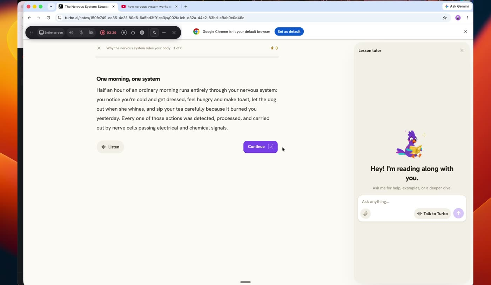

A check with its correction **in place**, not in a separate screen — the wrong answer
and the sentence explaining it sit under the question:

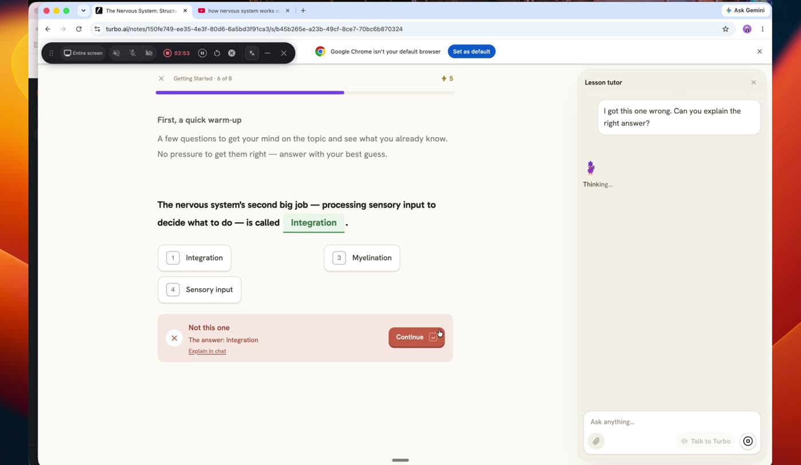

A question step — four options, one advance control, nothing else:

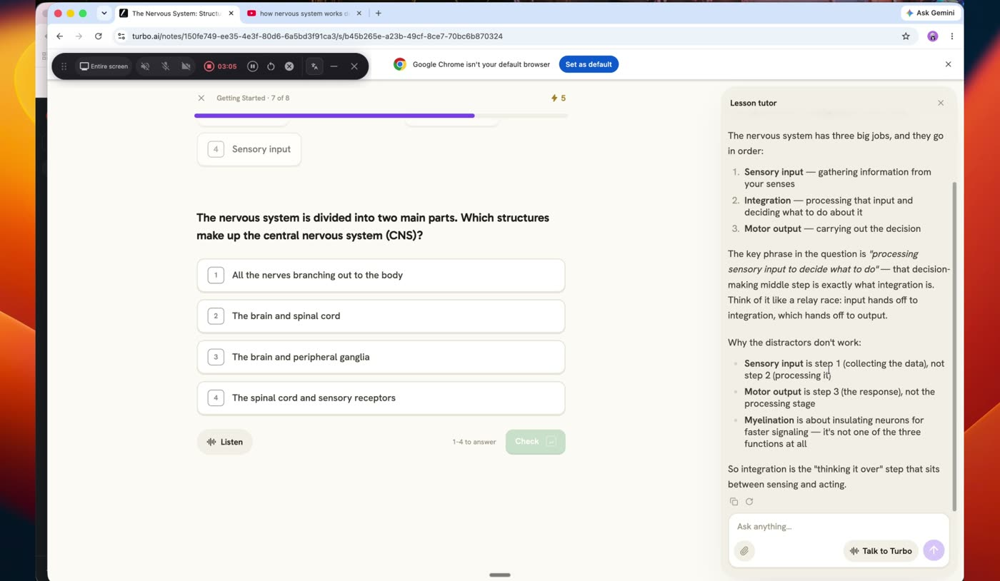

A table step — the comparison is the whole screen, and the tutor panel is carrying the
current step as its context:

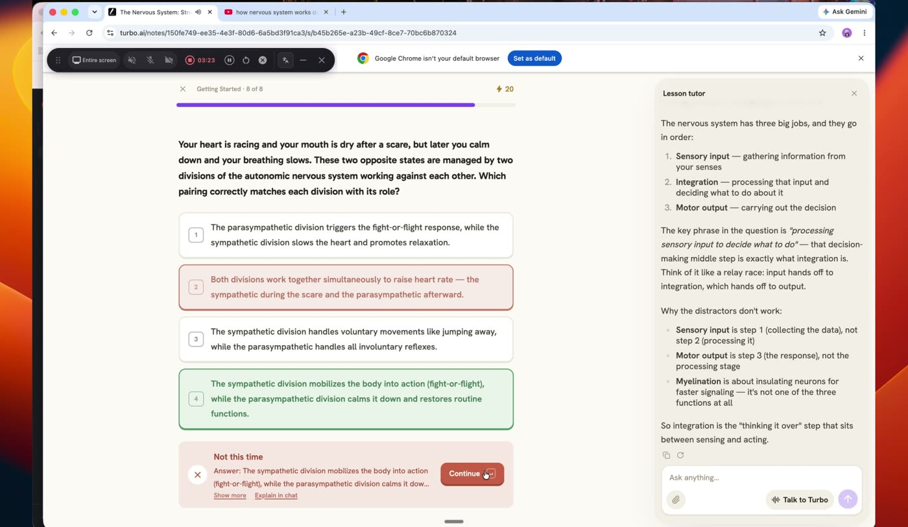

## 3. The flow

### 3.1 Pelajaran home

The home is a box and two lists. Nothing else above the fold.

```
   ┌────────────────────────────────────────────┐
   │  Mau belajar apa?                          │
   │  Tulis topik, atau taruh PDF dan slide     │
   │  kuliahmu di sini.                    [→]  │
   └────────────────────────────────────────────┘

   Kurasi
   ┌──────────┐ ┌──────────┐ ┌──────────┐
   │ Saraf    │ │ Kardio   │ │ Hematologi│
   │ kranial  │ │ SKA      │ │ anemia    │
   └──────────┘ └──────────┘ └──────────┘

   Punyamu                                   ← only when it exists
   ┌──────────┐
   │ Kuliah   │
   │ Blok     │
   │ Saraf.pdf│
   └──────────┘
```

**Kurasi is the atlas** (§5): 1,648 lessons already mapped across 17 systems, each with
what it must cover and which subtopik it belongs to.

**Reference** — Turbo's home is the same shape: one box, then the list under it.
Record / Upload / YouTube sit _inside_ the box as three ways to feed it.

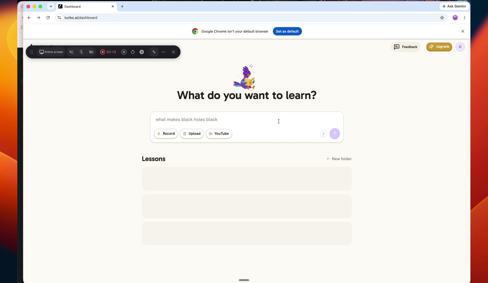

The box **resolves, it does not converse**:

| Input            | What happens                                           |
| ---------------- | ------------------------------------------------------ |
| A topic we have  | Opens the lesson.                                      |
| A topic we don't | Says so. Offers to have it written, or hands to Tanya. |
| A question       | Goes to Tanya. The box does not answer.                |
| A file           | Becomes a private lesson, listed under **Punyamu**.    |

The third row matters most: **the box asks what you want to learn; Tanya answers what
something means.** Merging the two is where Turbo's medical errors come from — it
generated an answer where it should have looked one up.

**Reference** — when the source is the student's own, the wait is a named screen rather
than a spinner: _"Lesson from Your Video"_, a progress bar, and one line saying what it
is doing.

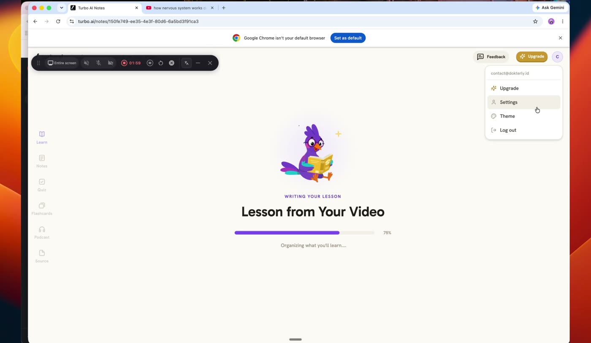

### 3.2 Clicking a lesson shows the roadmap

Not the first step. The **roadmap** — the sections, their states, and what's next:

```
   Anemia mikrositik
   Hematologi & Imunologi · 5 bagian · sekitar 25 menit

   1  Pemanasan                            selesai
   2  Kenapa sel jadi kecil                selesai
   3  Membaca panel besi                   sedang
   4  Membedakan tiga penyebab             belum
   5  Tatalaksana dan rujukan              belum

                                   [ Lanjut bagian 3 ]
```

Every section is open. Nothing is locked, and a missed day leaves no debt — the same
rule the plan already lives by.

**Reference** — Turbo's roadmap carries three things we should keep: a **state per
section** (done, current, locked), the **section it is writing right now**, and a single
**Continue** at the top with the next section named. What we drop is the locking.

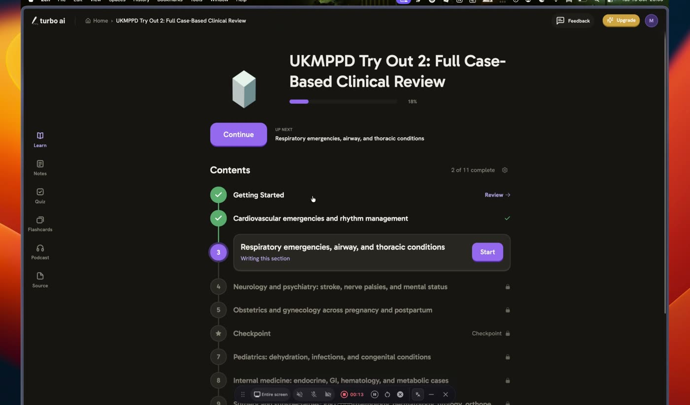

### 3.3 Then the player

Title card → the counted steps → the section close → back to the roadmap. The next
section's title card fires when they enter it.

## 4. The lesson, structurally

**A lesson is sections. A section is a counted number of steps.**

The step kinds the player renders:

| Kind       | What it is                                                       |
| ---------- | ---------------------------------------------------------------- |
| `jelas`    | One heading, one short paragraph, key terms bold. The workhorse. |
| `tabel`    | A comparison with one lead sentence saying what to look at.      |
| `gambar`   | A figure with real values. Never a generated medical image.      |
| `jebakan`  | One sentence on the thing that costs marks. Its own surface.     |
| `cek`      | Three options, retry allowed, a sentence per wrong option.       |
| `isian`    | A blank and chips. For numbers to know cold.                     |
| `urutkan`  | Reorder steps, partial credit per position.                      |
| `soal`     | A full exam item, one try, then the explanation.                 |
| `jembatan` | One line connecting to what's next.                              |

**Reference** — the title card. A kicker, the section name, and a short rule beneath it.
Held for about a second, then the first step fades in. Ours keeps the shape and drops
the all-caps kicker.

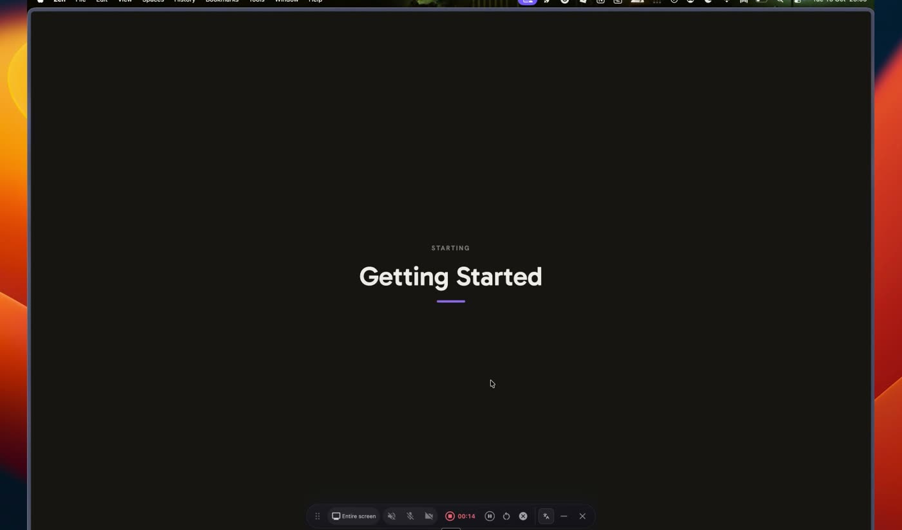

**Reference** — the Source tab, which is how the student sees what the lesson was built
from. When the source is their own file or a video it should be visible and revisitable,
not hidden behind the generation step.

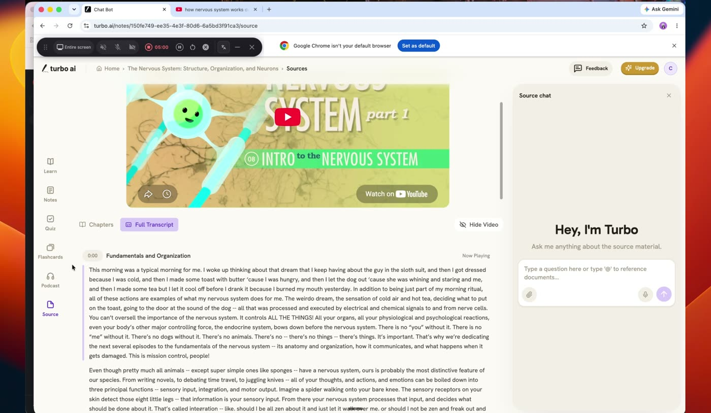

## 5. The curated shelf

The shelf is not hypothetical. It is already mapped: five bimbel batches merged and
restructured into Dokterly's shape.

**The hierarchy is `system → topic → lesson`** — 17 systems, 949 topics, and **1,648
lessons** of 8–12 minutes each. A lesson is _one entity for one exam task_ in one
sitting.

Each lesson in the atlas carries:

| Field   | What it is                                                           |
| ------- | -------------------------------------------------------------------- |
| `title` | The catalog name: `Entity: what this lesson covers`                  |
| `scope` | One sentence saying exactly what it must cover                       |
| `task`  | Which of the nine tasks it is (below)                                |
| `sub`   | The Dokterly subtopik it lives under                                 |
| `refs`  | The bimbel pages it came from, per batch                             |
| `diff`  | Its differential candidates — the lessons it must be told apart from |
| `d`     | The **display title**: the warm line the student sees in the player  |

**The nine tasks**, with how often each occurs across the 1,648:

| Task                 | n   | What it is                                                          |
| -------------------- | --- | ------------------------------------------------------------------- |
| `kenali`             | 503 | Recognise and confirm: presentation, key sign, key test, criteria   |
| `kenali+tatalaksana` | 459 | Both, only where the whole entity still fits one sitting            |
| `tatalaksana`        | 349 | First-line management, dose, what to do at FKTP, when to refer      |
| `dasar`              | 130 | A foundation skill, named by the skill: reading an EKG, sensitivity |
| `komplikasi`         | 69  | Complications the exam asks about on their own                      |
| `bandingkan`         | 65  | A deliberate comparison — telling A from B is the skill             |
| `populasi`           | 31  | The same entity where the population changes management             |
| `medikolegal`        | 21  | A duty, document or law                                             |
| `prosedur`           | 21  | A protocol                                                          |

**Two things the atlas gives us that Turbo has no equivalent of:**

1. **A display title separate from the catalog name.** The catalog says
   `Anemia defisiensi besi: gambaran klinis dan pola laboratorium`; the player says
   _"Membaca MCV, RDW dan retikulosit"_. One is for the index, one is for the student,
   and the atlas already holds both for all 1,648.
2. **Differential candidates** — 582 pairs. A lesson about anemia mikrositik knows which
   other lessons it must be distinguished from, which is exactly what a `bandingkan`
   lesson or a `cek` step needs. Turbo has no notion of the pair at all.

**The licensing boundary, stated plainly.** The source material is unlicensed commercial
bimbel content, so the atlas is a **coverage map only**: it tells us which lessons exist
and what each must cover — never their text, never their questions. The words have to
come from our own sources. That is a feature rather than a constraint: it is why the
lesson text can be cited and reviewed.

**Where it lands in the app.** Every lesson names the Dokterly subtopik it belongs to.
The atlas maps to 165 distinct subtopik against the 146 in the app and marks the rest
`Usulan baru`, so it also tells us which headings we are missing.

## 6. Tanya, docked

Tanya is the lesson's other half, and it belongs **on the side**, not as a separate
destination.

- **Always present.** A docked panel on wide screens, a sheet on narrow ones. It never
  covers the step.
- **It knows where you are.** The panel carries the current step as a context chip — the
  question text and the section name — so a follow-up is about the thing on screen.
- **The lesson hands it the miss.** On a wrong `cek` or `soal`, the inline sentence
  explains _that option_; a **"Tanya soal ini"** link opens Tanya with the soal, the
  option the student picked, and the options **in their displayed order**, so "opsi B"
  means what the student saw. Turbo gets this wrong: its "Explain in chat" labels the
  options A–D in a different order from the screen.
- **One thread per lesson**, not per step. Turbo opens a fresh empty thread every time
  the panel is opened, so the earlier question is gone.
- **It answers with citations**, from the corpus. The lesson's own pages carry their own
  source chip. Two different jobs: the page tells you what to know, Tanya answers what
  you asked.

**Reference** — the panel is docked, never covers the step, and carries the current step
as a context chip above the input. That chip is the whole trick: it is why a follow-up
question is about the thing on screen rather than about the topic in general.

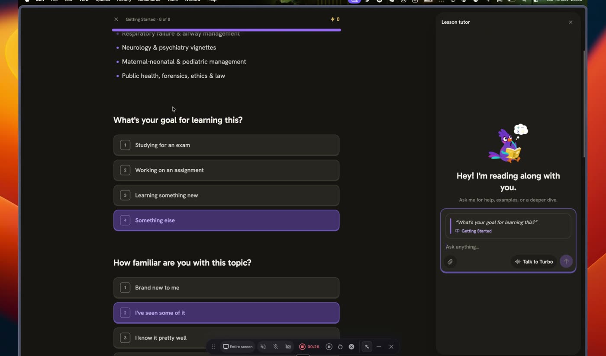

## 7. The copy

Short, second person, "kamu", never a system message where a person would speak.

| Moment                         | Ours                                                                 |
| ------------------------------ | -------------------------------------------------------------------- |
| Opening a warm-up              | "Nggak apa-apa salah. Ini buat mengukur."                            |
| A wrong answer                 | "Belum tepat, lihat lagi." + the sentence for the option they picked |
| A right answer                 | "Nah, itu dia."                                                      |
| The tutor panel                | "Baca bareng kamu."                                                  |
| A topic with nothing behind it | "Belum ada materinya."                                               |

House rules still apply: headlines dumb-simple, no exclamation marks outside chips and
buttons, and **no all caps** — Turbo's `STARTING` and `WRITING YOUR LESSON` kickers
become sentence case.

## 8. Sound

**Sound here means feedback, not narration.** The lesson should be audible the way a
good app is audible: you know you got it right without reading.

The vocabulary is small and fixed, one sound per event:

| Event              | The sound                                                           |
| ------------------ | ------------------------------------------------------------------- |
| A correct answer   | short, bright, rising — the only one that should feel like a reward |
| A wrong answer     | soft and low, not a buzzer, and never punishing                     |
| A retry that lands | the correct sound, slightly quieter than a first-try hit            |
| A section close    | a short two-note resolve; the biggest one in the set                |
| The title card     | a soft cue, so a section starting has a beginning                   |
| A lesson finished  | reserved for this and nothing else                                  |

Rules:

- **Never required.** Every screen is complete with the volume off, and there is one
  global mute that also covers the OS-level case.
- **Never on a delay.** The sound lands with the state change, not after it.
- **Short.** Under a second. Nothing loops.
- **No jingle.** If it sounds like a game show, it is wrong.
- **Respect reduced motion's sibling.** A student who mutes sound is the same kind of
  student as one who reduces motion; both get the same product, quieter.

Read-aloud narration — a voice that reads the lesson — is a **separate decision**, not
this one. Turbo asks for it during onboarding, and it is a real feature, but it costs
per character and it changes what the lesson is. Keep it out of scope here.

## 9. The ending

Turbo ends on an accuracy ring and an XP counter. Both are cheap: the ring counts
_tries_, so it moves down for reasons the student cannot explain, and XP is a tap
counter with no meaning.

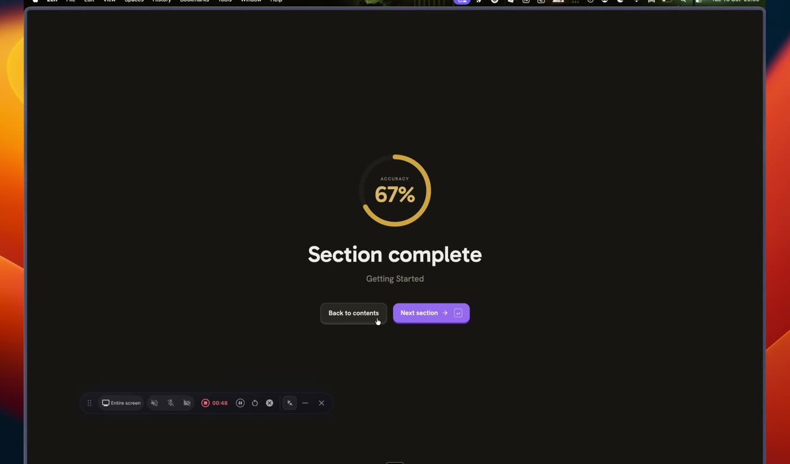

**A percentage is the wrong ending.** The replacement is four things, in this order:

1. **The moment.** The brand reserves yellow for a result, and this is a result. One
   yellow moment, used once, at the close of a section.
2. **What changed, in words.** Not a score — the specific gain:

   > "Kamu tidak lagi mengira feritin normal menyingkirkan ADB."

   That is the real dopamine, and it is honest, because we know the belief that was
   wrong before the lesson and is not wrong after it.

3. **The artefact.** The section itself, scrolled back, is the proof they built
   something. The ending points at it rather than replacing it.
4. **The consequence.** The estimate moved, and the misses are scheduled to come back.
   A lesson that leaves no trace in the plan is a side quest.

So: **no XP, no streak, no percentage as the headline.** A number may sit beside the
estimate, where a number means something, but the ending's headline is a capability.

## 10. What we deliberately do not copy

- **XP and the accuracy ring.** See §8.
- **All-caps kickers.** Brand says no all caps.
- **Generated medical images.** A figure carries real values or it does not ship.
- **The 3D morphing cover and the mascot.** The product is the illustration.
- **A paywall in the middle of a section.** Turbo walls the third section and again
  mid-topic. Ours should let one lesson finish.
- **Answering a question inside the lesson.** That is Tanya's job.
- **Branching the lesson by academic stage.** See §2.

## 11. What has to exist

Deliberately short, and deliberately not limited to what we already have.

- **A lesson and its steps as data**, authored and reviewed — not generated per student.
  The **inventory is already mapped** (§5): 1,648 lessons with what each must cover, its
  task, its subtopik and its differentials. What does not exist is the text inside them.
  Where that text comes from is a source decision, not a structural one: our own Materi
  and bank are the cheapest and most reviewed sources, but a video, a student's own file,
  or newly written copy are all legitimate. **Existing content is an augmentation, not
  the constraint.**
- **A step player**: one beat, deliberate advance, steps accumulating into one page.
- **The title card** and the section close.
- **The roadmap screen**, between the home and the player.
- **Tanya docked**, with the step as context and the miss handed to it.
- **The sound set**, and a global mute.
- **The ending read**: the belief that died, the estimate, the scheduled review.
- **The home**: the box, and the two lists.

## 12. Open decisions

1. **Where the gate sits.** Turbo allows two sections then walls. One lesson should
   finish; where the limit lands after that is a pricing decision.
2. **Whether the box ever generates from nothing.** I would say no: "belum ada
   materinya" is the line that keeps us out of Turbo's quality hole, and it costs a "no".
3. **Where `Pelajaran` sits in the sidebar.** Second, or after Latihan to leave the
   exam-taker's muscle memory alone.
4. **Whether the home hands the student anything.** A box-first home is the clearest
   thing to build and the easiest to explain, but it asks the student to know what to
   ask for. Worth watching whether they do.
